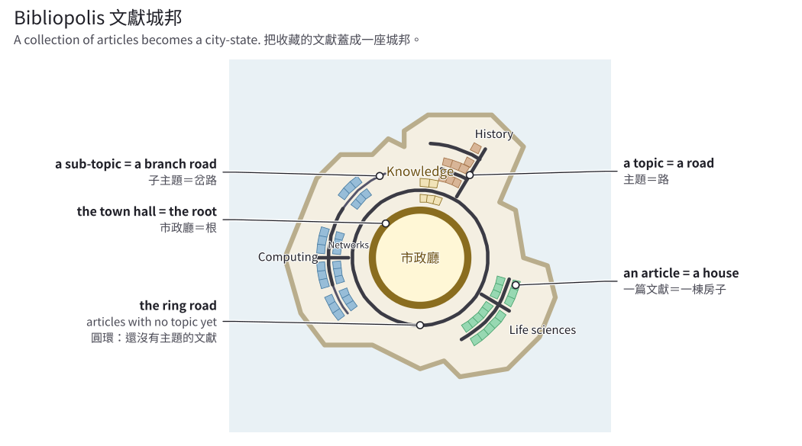
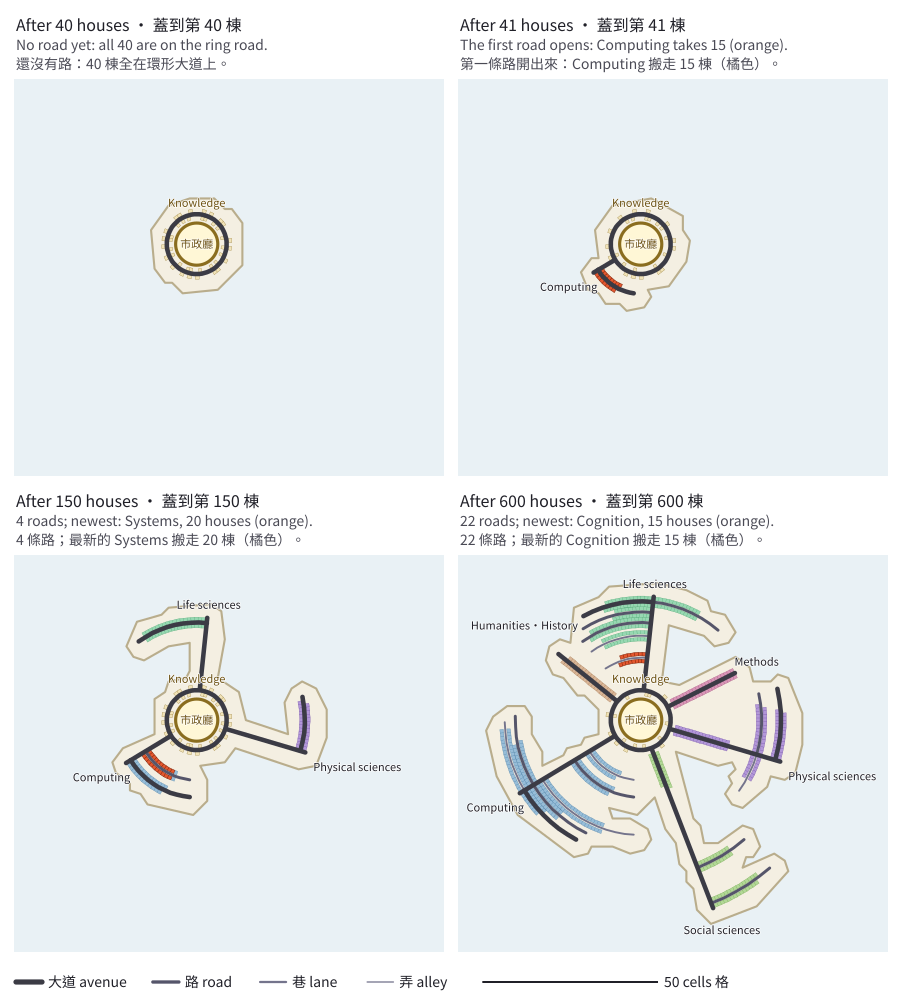
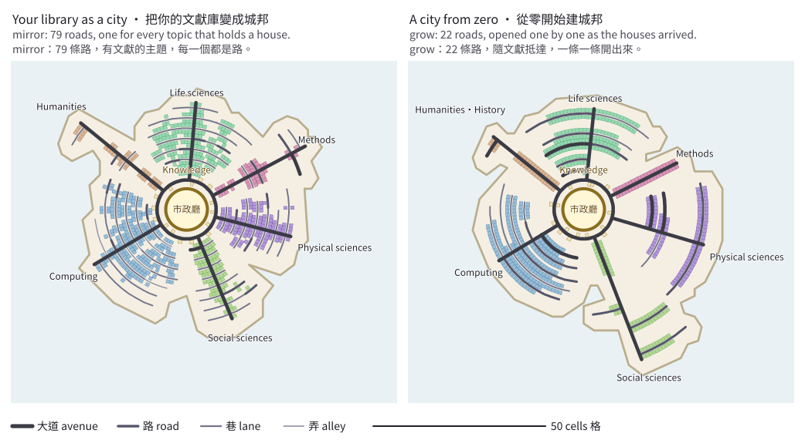

# Bibliopolis

Turn a literature collection into a city-state.



*A tiny invented city with its parts named. An article is a house. A topic is a road, and a sub-topic is a branch road. The town hall is the root of the topic
tree. Articles that have no topic yet live in the root zone, under the town hall.*

Every article is a house. Topics are roads that radiate from the town hall at the centre, and the tags of an article are the
residents of its house. The city grows as the collection grows.

**Status: early.** The city engine and its command line work, in both modes. There is no viewer yet, no Zotero import and no
ready-made topic tree: you bring a library file and a topic tree (formats: [docs/format.md](docs/format.md)). This repository is the
open extraction of a private, self-use project.

## How a city grows

A city starts as a town hall and nothing else. Each new article becomes a house at once, and it is built under the town hall, in the root zone. Nothing
stands above ground until the root zone holds more than 40 houses. Then the largest group of at least 10 houses that share a sub-topic moves out and opens
the first road. After that, any road that holds more than 40 houses opens a branch road for its own largest group in the same way.



*The example library (600 invented items) in `grow` mode, after 40, 41, 150 and 600 houses, on one frame. After 40 houses nothing stands above ground: all 40
are under the town hall. House 41 opens the first road, and the orange houses are the ones that moved. Later splits add roads and branch roads.*

The town hall keeps a chronicle of every split. The command prints it, one sentence per entry (the first four here):

```
python -m bibliopolis build --library examples/library.json --tree examples/tree.json --mode grow --out city.json
python -m bibliopolis chronicle --city city.json --limit 4
```

```
house 41, 2019-06-26: The root zone held 41 houses. Computing opens as a road with 15 of them; 26 stay.
house 62, 2019-10-15: The root zone held 41 houses. Physical sciences opens as a road with 12 of them; 29 stay.
house 85, 2020-01-26: The root zone held 41 houses. Life sciences opens as a road with 17 of them; 24 stay.
house 130, 2020-08-12: Computing held 41 houses. Systems opens as a road with 20 of them; 21 stay.
```

To see the city as it was at house 41, build it again with `--first 41` and draw it. The directions do not change: the plan reads the whole library before the
first house is built, so every road points the same way as in the full city. This is the same city at an earlier moment.

```
python -m bibliopolis build --library examples/library.json --tree examples/tree.json --mode grow --first 41 --out city-41.json
python -m bibliopolis picture --city city-41.json --out city-41.svg
```

## Two modes

- **Your library as a city (`mirror`).** Your topic tree (for Zotero, the collection tree) is the street plan: every topic an item is
  filed under is a road from the start, and so is every topic above one. An item stands once, at its deepest topic. Items arrive in the
  order you added them, so the growth of the city can be replayed. Items in no topic live underground, below the town hall. A road that
  holds more than 40 houses is marked as crowded.
- **A city from zero (`grow`, data-driven).** Houses arrive one at a time and the roads grow from the data:
  - The first houses live underground, below the town hall.
  - A road holds 10 to 40 houses directly.
  - When a road holds more than 40, the largest group of at least 10 of its houses that share a sub-topic moves out and opens a new
    road.
  - Every split is written into the town hall's chronicle, where it can be checked and repaired.



*The same 600 items in both modes, on one frame. Left, `mirror`: the topic tree is the street plan. Right, `grow`: the roads opened one by one as the houses
arrived.*

## Try it

Python 3.11 or newer. Nothing to install: the package uses the standard library only.

```
python -m bibliopolis build --library examples/library.json --tree examples/tree.json --mode grow --out city.json
python -m bibliopolis build --library examples/library.json --tree examples/tree.json --mode mirror --out city-mirror.json
python -m bibliopolis picture --city city.json --out city.svg
```

The example is a synthetic library of 600 items on a tree of 80 topics, made by `examples/make_example.py`; every title, author and DOI
is invented. In `grow` mode the first road opens at the 41st item, one topic (Networks) holds more than 40 houses of its own and is
marked over, and the chain Humanities / History becomes one road. The `build` command says what it made:

```
wrote city.json: 600 houses on 22 roads, 15 under the town hall, 22 splits, 1 over (mode grow)
```

`city.json` holds the geometry and the structure of the city, not the titles: those stay in your library file. The same input gives the
same file, byte for byte. `picture` draws a city as one SVG file that opens in a browser, and `chronicle` prints what happened in it. Formats are in
[docs/format.md](docs/format.md), the rules in [docs/engine.md](docs/engine.md).

Your own files: a library `{"items": [...]}` in which every item has `id`, `title`, `authors`, `year`, `added_at`, `type`, `tags` and
`topics` (and, if you like, `doi`), and a tree `{"nodes": [{"id", "label", "parent"}, ...]}`. A wrong file is refused, with the place
of each problem. JSON Schema files are in `schema/`.

## Tests

```
python -m pip install pytest
python -m pytest
```

The pictures of this page are made by `examples/make_pictures.py` from the example. A test makes them again and compares them with the files in
`docs/images/` byte for byte, so they cannot go stale. After a change to the engine or the example, run `python examples/make_pictures.py` and commit
the result.

## Principles

- One article, one house. Only articles are buildings; the town hall is a plaza.
- No full text, abstracts, figures or media are stored: bibliographic metadata, your classification and your own notes only.
- Text and code only in Git; the one exception is PNG images directly under `docs/images/` (pixels only, at most 1 MiB each).

## License

[MIT](LICENSE)

---

# 文獻城邦

把收藏的文獻蓋成一座城邦。


*一座虛構的小城邦，標出各個部分。一篇文獻是一棟房子，一個主題是一條路，子主題是岔路，市政廳是主題樹的根。還沒有主題的文獻，住在市政廳地下的根區。*

一篇文獻是一棟房子。主題是從市政廳往外放射的路，文獻的標籤是房子裡的居民。收藏越多，城邦越大。

**狀態：起步中。** 城邦引擎與命令列已經可以用，兩種模式都有。目前還沒有檢視器，還不能直接匯入 Zotero，也沒有現成的主題樹：
你要自備文獻庫檔案與主題樹（格式見 [docs/format.md](docs/format.md)）。這個 repo 是一個私人自用專案的開源版。

## 城邦怎麼長大

一座城邦一開始只有市政廳。每一篇新文獻立刻蓋成一棟房子，蓋在市政廳地下的根區。根區住滿 40 棟之前，地面上什麼都沒有。超過 40 棟時，
同一個子主題、至少 10 棟的最大一組房子搬出去，開出第一條路。之後任何一條路超過 40 棟，就用同樣的方法，為它自己最大的一組房子開一條岔路。


*範例文獻庫（600 筆虛構文獻）在 `grow` 模式下，蓋到第 40、41、150、600 棟時的樣子，四張圖用同一個畫面。蓋到第 40 棟時地面上什麼都沒有，40 棟全住在市政廳地下。
第 41 棟讓第一條路開出來，橘色是搬出去的房子。之後的分路陸續長出更多路與岔路。*

市政廳會記下每一次分路，寫成市政紀事。下面的指令把它印出來，一筆一句（這裡只列前四筆）：

```
python -m bibliopolis build --library examples/library.json --tree examples/tree.json --mode grow --out city.json
python -m bibliopolis chronicle --city city.json --limit 4
```

```
house 41, 2019-06-26: The root zone held 41 houses. Computing opens as a road with 15 of them; 26 stay.
house 62, 2019-10-15: The root zone held 41 houses. Physical sciences opens as a road with 12 of them; 29 stay.
house 85, 2020-01-26: The root zone held 41 houses. Life sciences opens as a road with 17 of them; 24 stay.
house 130, 2020-08-12: Computing held 41 houses. Systems opens as a road with 20 of them; 21 stay.
```

想看蓋到第 41 棟時的城邦，加上 `--first 41` 再蓋一次，然後把它畫出來。路的方向不會變：規劃在蓋第一棟房子之前，就已經讀過整份文獻庫，所以每條路的方向都和完整城邦相同。這是同一座城邦在較早的時刻。

```
python -m bibliopolis build --library examples/library.json --tree examples/tree.json --mode grow --first 41 --out city-41.json
python -m bibliopolis picture --city city-41.json --out city-41.svg
```

## 兩種模式

- **把你的文獻庫變成城邦（`mirror`）。** 你的主題樹（用 Zotero 的話，就是 collection 樹）就是路網：文獻歸在哪些主題，那些主題一開始就是路，
  它們上面的主題也是。一篇文獻只蓋一棟房子，蓋在它最深的那個主題。文獻依加入的先後抵達，所以城市的成長可以回放。沒有主題的文獻，住在市政廳正下方的地底。
  一條路住超過 40 棟，會被標成擁擠。
- **從零開始建城邦（`grow`，依資料長出來）。** 房子一棟一棟進來，路依資料自己長出來：
  - 最早的房子住在市政廳正下方的地底。
  - 一條路直接住 10 到 40 棟。
  - 一條路超過 40 棟時，把同一個子主題、至少 10 棟的最大一組房子搬出去，開一條新路。
  - 每一次分路都記在市政廳的市政紀事裡，可以查，也可以修補。


*同樣的 600 筆文獻，兩種模式，同一個畫面。左：`mirror`，主題樹就是路網。右：`grow`，路隨文獻抵達，一條一條開出來。*

## 試試看

需要 Python 3.11 以上。不用安裝任何東西，套件只用標準函式庫。

```
python -m bibliopolis build --library examples/library.json --tree examples/tree.json --mode grow --out city.json
python -m bibliopolis build --library examples/library.json --tree examples/tree.json --mode mirror --out city-mirror.json
python -m bibliopolis picture --city city.json --out city.svg
```

範例是一個合成的文獻庫：80 個主題、600 篇文獻，由 `examples/make_example.py` 產生，標題、作者與 DOI 都是虛構的。在 `grow` 模式下，
第 41 篇文獻讓第一條路開出來；有一個主題（Networks）自己就住了超過 40 棟，被標成超額；Humanities / History 這條單一路徑的主題鏈，合併成一條路。
`build` 指令會告訴你它蓋出了什麼：

```
wrote city.json: 600 houses on 22 roads, 15 under the town hall, 22 splits, 1 over (mode grow)
```

`city.json` 只放城邦的幾何與結構，不放標題；標題留在你自己的文獻庫檔案裡。相同的輸入會得到逐位元組相同的檔案。`picture` 把城邦畫成一個可以用瀏覽器開啟的 SVG 檔，
`chronicle` 印出城邦裡發生過的事。格式見 [docs/format.md](docs/format.md)，規則見 [docs/engine.md](docs/engine.md)（英文）。

用你自己的檔案：文獻庫 `{"items": [...]}`，每筆文獻要有 `id`、`title`、`authors`、`year`、`added_at`、`type`、`tags`、`topics`
（`doi` 可有可無）；主題樹 `{"nodes": [{"id", "label", "parent"}, ...]}`。檔案有誤時，指令會拒絕執行，並指出每個問題在哪裡。
`schema/` 裡有 JSON Schema 檔。

## 測試

```
python -m pip install pytest
python -m pytest
```

這一頁的圖由 `examples/make_pictures.py` 從範例產生。測試會重新產生這些圖，和 `docs/images/` 裡的檔案逐位元組比對，所以圖不會過期。
改了引擎或範例之後，執行 `python examples/make_pictures.py`，再把結果提交。

## 原則

- 一篇文獻一棟房子。只有文獻是建築，市政廳是廣場。
- 不存全文、摘要、圖表或影音；只存書目資料、你的分類與你自己的筆記。
- Git 裡只有文字與程式；唯一的例外是直接放在 `docs/images/` 底下的 PNG 圖片（只含像素，每張不超過 1 MiB）。

## 授權

[MIT](LICENSE)
